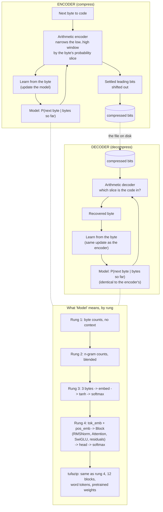

# Onboarding (for engineers)

This is a **study fork** of [Tufalabs/tufazip](https://github.com/Tufalabs/tufazip),
a Transformer + arithmetic-coder compressor for `enwik9` (1 GB of Wikipedia, down to
about 101 MB). The real decoder needs 2x NVIDIA B200 GPUs and roughly 7.5 days, so it
is never run here. Instead, `exercises/` rebuilds the same idea at toy scale, in four
steps ("rungs"), so you can read, run and change every part on a laptop.

Everything is on the `learn` branch. `master` is untouched upstream code.

**Not an engineer?** Read [EXPLAINER.md](EXPLAINER.md) instead. It has the same story
in plain language.

## Suggested reading order

1. This page: the pipeline diagram, the results, and how to run things.
2. `exercises/01` to `04`, in order. Each file's docstring explains *why* it exists.
3. `exercises/attention_by_hand.py`: attention on three tokens, with every number
   printed. Read it between rungs 3 and 4.
4. `exercises/05_sample_size.py`: how the rungs compare as the input shrinks.
5. `nn.py` (the real model). Rung 4 deliberately mirrors it; see "Map to nn.py" below.
   A line-by-line guide (`NN_WALKTHROUGH.md`) is planned but not written yet.

## Quick start

The exercises run in a small CPU-only Docker image (Python 3.12, torch, numpy). It is
**not** the real decoder's environment, whose pinned stack is in `uv.lock`.

```bash
# once, from the repo root
docker build -f Dockerfile.learn -t tufazip-learn .

# then run any exercise
docker run --rm -v "$PWD":/work tufazip-learn python exercises/01_order0_coder.py
```

| Exercise | What it shows | Time (M1 Pro, 1 thread) |
|---|---|---|
| `01_order0_coder.py` | Arithmetic coder + adaptive byte counts | seconds |
| `02_ngram_mixing.py` | Context models of orders 0..k, blended (Witten-Bell) | ~1 min |
| `03_tiny_neural_numpy.py` | Small neural net, hand-written backprop (numpy) | ~1 min |
| `attention_by_hand.py` | Attention on 3 tokens, checked against PyTorch | seconds |
| `04_tiny_transformer.py` | Tiny causal Transformer (PyTorch), online learning | ~3 min (8 KB); ~15 min for the full file |
| `05_sample_size.py` | Rungs 1-4 on 2 KB ... 40 KB prefixes | ~15 min |

Each rung encodes **and** decodes, then asserts the round trip is byte-identical.
To run rung 4 on the whole sample, set `N_BYTES = None` near the top of
`04_tiny_transformer.py`.

## Results

`exercises/sample.txt` is the first 39,785 bytes of *Pride and Prejudice*. Bits per byte
(lower is better; raw text = 8.000):

| Rung | Model | bits/byte | ratio |
|---|---|---|---|
| 1 | adaptive order-0 byte counts | 4.638 | 1.72x |
| 2 | context n-gram (order 3 best), blended | **2.652** | **3.02x** |
| 3 | tiny neural net (numpy) | 3.364 | 2.38x |
| 4 | tiny Transformer (PyTorch) | 3.064 | 2.61x |

**The count table wins here, and that is the point.** Sample size changes the picture
(bits/byte on the first N bytes of the same file):

| bytes | order-0 | n-gram o3 | n-gram o5 | tiny net | Transformer |
|---|---|---|---|---|---|
| 2,000 | 5.120 | **3.800** | 3.912 | 5.304 | 5.188 |
| 5,000 | 4.922 | **3.363** | 3.502 | 4.523 | 4.294 |
| 10,000 | 4.822 | **3.092** | 3.236 | 4.026 | 3.774 |
| 20,000 | 4.707 | **2.840** | 2.977 | 3.669 | 3.377 |
| 39,785 | 4.638 | **2.652** | 2.758 | 3.364 | 3.064 |

What this supports:

- Every model improves with more data; the neural nets improve most (Transformer
  -2.12 bits/byte from 2 KB to 40 KB, n-gram o3 -1.15).
- Neural nets pay a start-up cost: at 2 KB both are *worse* than order-0 counting.
- The Transformer's gap to the n-gram o3 shrinks at every size (1.39, 0.93, 0.68, 0.54,
  0.41 bits/byte).

What it does **not** support:

- **No crossover was observed.** The n-gram table is ahead at every size we measured.
  Extrapolating the gap is speculation, and the per-doubling gain is also slowing.
  Finding a crossover needs far more text (the full novel is ~700 KB; rung 4 on it
  would take hours).
- Every sample is a **prefix of one book**, so small samples are just chapter 1.
- Rung 4's learning rate (`3e-3`) was picked, not tuned. Rung 3's history showed LR
  can swing results a lot.
- The order-5 table trailing order 3 by ~0.11-0.14 at every size is measured, but the
  "sparse tables" explanation for it is not shown by this data.

Why this matters for the real model: tufazip avoids the start-up cost by shipping
**pretrained weights** (`weights.bin`, 4.3 MB) and by working on 1 GB of input.

## The overall workflow

Every exercise in `exercises/` (rungs 1-4) and tufazip itself share one pipeline:
**predict, code, learn, repeat.** The encoder and decoder are mirror images. The only
thing that changes between rungs is the box labelled "Model".



### How to read it

- **Solid arrows** are data flow. Each loop is "predict, code, learn, predict again".
- **The dotted arrow** between the halves is the only thing that crosses from encoder
  to decoder: the compressed bits. The decoder has no other copy of the data.
- **The two model boxes must be identical at every step.** One differing float and
  everything after it turns to garbage. This is why tufazip pins exact hardware and
  library versions.

### Two ideas the diagram encodes

- **The arithmetic coder never sees the model.** It receives probabilities and a
  symbol. It does not know whether a count table or a Transformer produced them, so
  the same `arithmetic_coder.py` serves all four rungs and tufazip.
- **Learning happens after coding each byte, on both sides.** Both sides learn only
  from bytes the decoder already has, so the decoder can repeat every update.

Mermaid renders on GitHub. Locally, paste the block into <https://mermaid.live>.

## Map to `nn.py`

Rung 4 is `nn.py` shrunk down, kept deliberately close so you can read them side by side.

| Rung 4 (`04_tiny_transformer.py`) | `nn.py` | Notes |
|---|---|---|
| `RMSNorm` | `RMSNorm`, line 125 | Same maths (nn.py upcasts to float32 first) |
| `Attention` | `Attention`, line 152 | `F.scaled_dot_product_attention(..., is_causal=True)` is nn.py line 189 |
| `SwiGLU` | `SwiGLU`, line 220 | Identical |
| `Block` | `Block`, line 231 | nn.py defaults to "peri" norm placement (extra norms); rung 4 uses plain pre-norm |
| `TinyTransformer` | `Transformer`, line 262 | |
| learned `pos_emb` | RoPE, lines 137-149 | Deliberate simplification |
| tied head/embedding | `tie_emb`, line 294 | V2_CONFIG sets `untie_embeddings=True` |

| | tufazip V2 (`V2_CONFIG`, nn.py line 39) | rung 4 |
|---|---|---|
| vocabulary | 4,097 word tokens | 256 bytes |
| layers | 12 | 1 |
| `d_model` | 1024 | 64 |
| heads | 8 | 4 |
| `d_inner` | 2816 | 176 |
| context | 192 tokens | 32 bytes |
| parameters | ~160 M | ~69 k |

Left out of rung 4 on purpose: QK-norm, "peri" norm placement, `block_schedule`,
`learned_relative` attention, dropout, bf16, distributed training, and the retraining
schedule. `attention_by_hand.py` agrees with PyTorch's attention, the very call in
`nn.py`.

## Repository map

| Path | What it is |
|---|---|
| `nn.py` | The real model and codec (upstream) |
| `arithmetic_coder.py` | The arithmetic coder every exercise reuses (upstream) |
| `preprocess.c`, `enwik9.voc` | Tokenizer and vocabulary (upstream) |
| `weights.bin` | 4.3 MB quantized starting weights (upstream) |
| `Dockerfile.learn` | CPU-only image for the exercises (this fork) |
| `exercises/` | The rungs, `attention_by_hand.py`, the sample-size experiment, `sample.txt` (this fork) |
| `docs/` | These write-ups (this fork) |

## Gotchas

- **Determinism is the whole game.** The decoder must replay the encoder's model
  updates exactly. The exercises round-trip because encode and decode run in the same
  container on the same machine, with one thread (`torch.set_num_threads(1)`). Across
  different hardware or library versions, float differences could break decoding. That
  is why the real tufazip pins its stack.
- **Rung 4 is slow on CPU by design:** one forward+backward per byte, plus two replay
  steps. About 11 ms per byte.
- **`sample.txt` is a Project Gutenberg text** fetched from the official mirror
  `gutenberg.pglaf.org` (the main site was down for maintenance at the time).
- **Docker Desktop on macOS** briefly failed to see a just-created file in the mounted
  folder once; re-running fixed it.
- **Remotes:** `origin` is this fork, `upstream` is Tufalabs. This work is for study and
  is not intended as a pull request to upstream.
